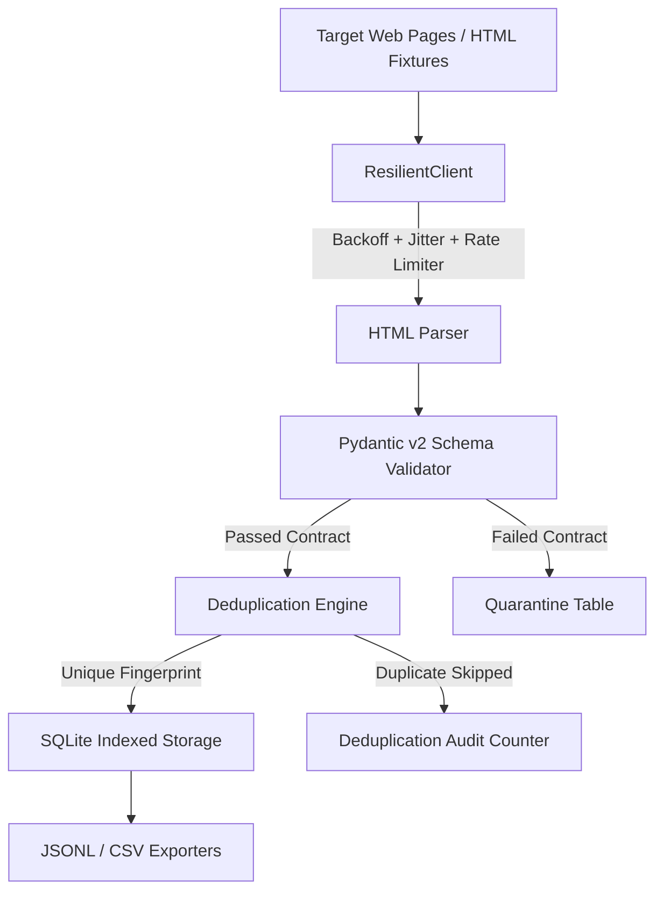

# MarketHarvester-ETL

[](https://github.com/loka0001/marketharvester-etl/actions)
[](https://opensource.org/licenses/MIT)
[](https://www.python.org/downloads/)
[](https://pydantic.dev/)

> **Resilient Multi-Source Web Extraction & Schema Validation Pipeline with Automated Quarantine Isolation and Deduplication.**

---

## Overview

Industrial web scraping and ETL pipelines frequently fail due to three core vulnerabilities:
1. **Transient Network Failures & Rate Limits:** Simple scripts crash on HTTP 429 or 5xx without backoff.
2. **Schema Drift & Corrupted Records:** Unvalidated scrapers pollute downstream databases with broken emails, truncated phones, or missing required fields.
3. **Duplicate Contamination:** Multi-page crawls ingest identical records with minor formatting variances.

**MarketHarvester-ETL** solves these problems with an enterprise-ready, defensive data pipeline architecture.



---

## Key Features

- **🛡️ Defensive Pydantic v2 Contracts:** Strict typing and field validators for emails (RFC conformant), phone numbers (E.164-style digit normalization), rating bounds (0.0 - 5.0), and postal addresses.
- **⚡ Zero Data Pollution Quarantine:** Any record failing validation is never dropped silently; it is routed directly to a dedicated `quarantine` table with exact validation error traces and the raw payload for auditability.
- **🔄 Deterministic Deduplication:** Computes normalized SHA-256 entity fingerprints from cleaned business names, domains, and cities, preventing duplicates regardless of spacing or protocol differences.
- **🌐 Resilient Network Engine:** Automated exponential backoff with random jitter, User-Agent rotation, polite inter-request delays, and explicit HTTP 429 handler.
- **💾 Multi-Format Storage:** Automated SQLite schema generation with performance indices (`category`, `city`, `hash_fingerprint`), idempotent `ON CONFLICT` upserts, plus streaming JSONL and CSV exporters.
- **🧪 100% Offline Testability:** Bundled realistic directory HTML fixtures allow running complete end-to-end integration test suites with zero external network dependencies.

---

## Installation

```bash
# Clone the repository
git clone https://github.com/loka0001/marketharvester-etl.git
cd marketharvester-etl

# Install with development dependencies
pip install -e .[dev]
```

---

## Quickstart & CLI Usage

Harvest directory listings directly from local files or live URLs:

```bash
# Run harvest pipeline against fixtures and output to SQLite + CSV
python -m marketharvester.cli \
    --sources fixtures/directory_page_1.html fixtures/directory_page_2_corrupted.html \
    --db output/companies.db \
    --csv output/companies.csv \
    --jsonl output/companies.jsonl
```

### Terminal Output Sample:

```text
==================================================================
MarketHarvester-ETL: Enterprise Extraction & Validation Pipeline
==================================================================
Sources to harvest: 2
Target Database:    output/companies.db
Target CSV:         output/companies.csv
Target JSONL:       output/companies.jsonl
------------------------------------------------------------------

--- Pipeline Execution Summary ---
  * Total Raw Scraped:      8
  * Valid Schema Records:   5
  * Quarantined (Corrupt):  2
  * Duplicates Deduplicated: 1
  * Pipeline Runtime:       0.042s
  * Database Total Stored:  5
==================================================================
```

---

## Python API Example

```python
from marketharvester.pipeline import HarvestPipeline
from marketharvester.storage import SQLiteStorage

storage = SQLiteStorage("data/market.db")
pipeline = HarvestPipeline(storage=storage)

valid_records, quarantined_records, report = pipeline.run(
    sources=["fixtures/directory_page_1.html"],
    csv_output="data/output.csv"
)

print(f"Accepted: {len(valid_records)} valid records")
print(f"Quarantined: {len(quarantined_records)} corrupt records")
```

---

## Running the Test Suite

```bash
pytest -v
```

All tests execute fully offline in sub-second time.

---

## License & Attribution

This project is authored by **Malek Mesbah** and licensed under the **MIT License**. See [LICENSE](LICENSE) and [ATTRIBUTION.md](ATTRIBUTION.md) for details.
